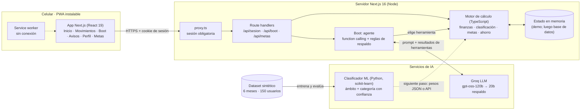

# Arquitectura de Mío + Boot

Concepto para el Hackathon BBVA AI Financial Life. Usa datos ficticios y no es un producto oficial.

**Mío** es una app **de gestión** de finanzas para el celular: consulta, clasifica, planifica y avisa. **No mueve dinero:** no hace transferencias, pagos ni cambio de moneda.

El perfil se define al iniciar sesión:
- **DNI → persona:** finanzas personales.
- **RUC → emprendedor o empresa:** el negocio separado de lo personal.

**Boot** es el asistente con IA. El código calcula; la IA entiende la pregunta y explica el resultado.

## 1. Diagrama de componentes



### Cómo responde Boot (secuencia)

```mermaid
sequenceDiagram
  participant U as Usuario (RUC)
  participant B as /api/boot
  participant L as Groq LLM
  participant M as Motor de cálculo
  U->>B: "¿Puedo reponer stock por S/ 500?"
  B->>B: lee el perfil de la cookie y elige las herramientas del perfil
  B->>L: prompt de sistema + pregunta + herramientas
  L-->>B: llamar simular_reposicion(monto=500)
  B->>M: simular_reposicion(500)
  M-->>B: {resultado: 357, falta: 143, días: 6}
  B->>L: resultado de la herramienta
  L-->>B: "No alcanza; te faltan S/ 143…"
  B-->>U: texto + tabla con los números del motor + "IA"
  Note over B,L: Si Groq falla o tarda más de 12 s, responde el motor de reglas
```

## 2. Componentes

| Componente | Dónde | Responsabilidad |
|---|---|---|
| App web / PWA | `frontend/app`, `frontend/components` | Pantallas para celular; se instala desde el navegador |
| Login DNI/RUC | `frontend/app/login`, `lib/sesion.ts` | Valida el documento (incluido el dígito verificador del RUC) y define el perfil |
| Proxy | `frontend/proxy.ts` | Sin sesión manda a `/login`; las API responden 401 |
| Motor de cálculo | `frontend/lib/finanzas.ts`, `clasificacion.ts`, `metas.ts`, `ahorro.ts` | Proyección a fin de mes, semáforo, duplicados, resumen del negocio, reposición, metas, ofertas. **Determinista** |
| Boot (agente) | `frontend/lib/llm.ts` | Function calling con Groq; herramientas distintas por perfil; controles de salida |
| Motor de reglas | `frontend/lib/boot.ts` | Respaldo sin IA, siempre disponible |
| Clasificador ML | `ml/` | Clasifica cada movimiento como negocio o personal, y su categoría, con confianza; evaluado contra un baseline |
| Dataset sintético | `ml/generar_dataset.py` | Datos reproducibles con casos difíciles |
| Estado | `frontend/lib/memoria.ts` | Metas, ahorro e historial del chat en memoria (demo) |

## 3. APIs

| Método y ruta | Entrada | Salida | Protección |
|---|---|---|---|
| `POST /api/sesion` | `{ documento, clave }` | `{ ok, perfil }` + cookie `mio.sesion` | Pública; valida DNI/RUC |
| `DELETE /api/sesion` | — | `{ ok }` y borra la cookie | Pública |
| `POST /api/boot` | `{ mensaje }` (máx. 300 caracteres) | `{ texto[], tabla?, chips?, fuente: 'groq' \| 'reglas', herramientas? }` | Sesión obligatoria |
| `POST /api/metas` | `{ accion: 'gasto' \| 'ahorro' \| 'separar', … }` | `{ ok, meta, ofertasNuevas? }` o `{ ok:false, error }` | Sesión obligatoria |

Las respuestas de Boot siempre traen los números en `tabla`, calculados por el motor, nunca por el LLM.

## 4. Seguridad y privacidad

- **Datos ficticios:** no hay datos reales, ni conexión a bancos, ni credenciales reales. La clave del login es de demo y no se guarda.
- **Sesión:**
  - cookie `httpOnly`, `sameSite=lax` y `secure` cuando la conexión es HTTPS;
  - el perfil se lee **en el servidor**: el cliente no puede pedir herramientas de otro perfil.
- **Claves:** `GROQ_API_KEY` vive solo en el servidor (`.env.local`, ignorado por Git). Nunca llega al navegador.
- **Límites del LLM:**
  - solo usa las herramientas permitidas para el perfil (lista blanca);
  - responde solo con datos de la app;
  - mensajes de 300 caracteres como máximo;
  - 4 vueltas como máximo y timeout de 12 s;
  - modelo de respaldo ante el límite de uso;
  - motor de reglas si todo falla.
- **Sin cifras inventadas:** el LLM no calcula. Las tablas salen del motor y la respuesta indica si vino de la IA o de las reglas.
- **Minimización de datos hacia el LLM:**
  - no se envían el DNI o RUC, el nombre del titular ni números completos de cuenta o tarjeta (solo los últimos 4 dígitos);
  - van el nombre de pila del usuario, los resultados de las herramientas y, cuando se consultan movimientos, sus descripciones (que pueden incluir nombres de comercios o personas).
  - En producción, esas descripciones también se anonimizarían.
- **Decisiones dudosas:** con confianza menor a 0.7, o con descripción genérica, el movimiento no se clasifica solo y el usuario confirma.
- **No es asesoría:** la app muestra simulaciones con datos del usuario; los préstamos y ofertas son ficticios.

## 5. Decisiones técnicas clave

| Decisión | Por qué | Alternativa descartada |
|---|---|---|
| Next.js + PWA | Una sola base de código para web y celular, sin tiendas de apps | App nativa: el doble de trabajo para el hackathon |
| El perfil se define por el documento (DNI/RUC) | Es como el usuario se identifica en Perú; el RUC ya indica que hay un negocio | Preguntar el perfil: el usuario puede equivocarse |
| El código calcula y el LLM explica (function calling) | Las cifras son verificables; la guía penaliza resultados inventados | Que el LLM calcule: inventa números |
| Groq `gpt-oss-120b` + respaldo | Gratis, rápido (~1–2 s) y soporta herramientas | Modelo local: lento sin GPU |
| Regresión logística + TF-IDF | Rápida, explicable, da probabilidades y gana a las reglas (F1 0.98 vs 0.84) | Deep learning: necesita más datos y es menos explicable |
| Umbral de confianza 0.7 | La app no decide sola cuando duda; la corrección del usuario sirve para reentrenar | Clasificar todo automáticamente |
| Estado en memoria | Suficiente para la demo | Base de datos: es el siguiente paso |
| Solo gestión, sin transferencias | Menos riesgo y foco en el valor diferencial (clasificar, planificar, avisar) | Operaciones bancarias |

## 6. Camino a producción

1. **Base de datos** (por ejemplo PostgreSQL) para sesiones, metas, correcciones del usuario e historial.
2. **Servir el clasificador ML**, ya sea con los pesos exportados a JSON para TypeScript o con un servicio Python (FastAPI). Reentrenar con las correcciones de los usuarios.
3. **Conexión a datos reales** mediante APIs del banco o de billeteras con consentimiento del usuario, más autenticación real (OAuth/OIDC y 2FA).
4. **Notificaciones push** (Web Push) para las metas y un **cierre mensual por correo**.
5. **Observabilidad:** registro de qué herramientas usa Boot, sus tiempos y errores; monitoreo del modelo (drift) por rubro.
